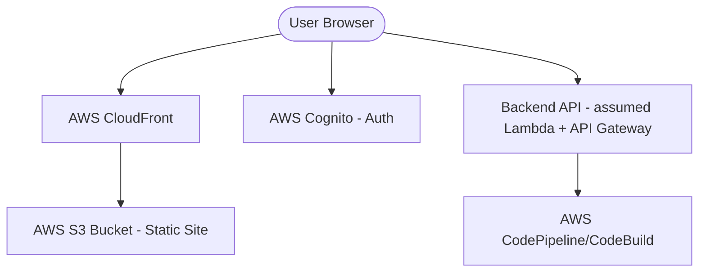

# Architecture Design Document (ADD)

> **Status: Draft – not approved.** This document describes the current frontend and the assumed backend. The architecture is not final. Statements marked _Unverified_, _Assumed_, _Unknown_ or _Planned_ have not been confirmed or built. For audit findings, see [CURRENT_STATE.md](./CURRENT_STATE.md).

## 1. System Overview

The Blueprint Deploy application is a decoupled frontend-backend system. This repository contains the React frontend, which communicates with a serverless backend on AWS.

## 2. Technology Stack

### 2.1 Frontend

- **Framework**: React 19
- **Build Tool**: Vite
- **Language**: TypeScript
- **Styling**: Tailwind CSS
- **Components**: Radix UI (Headless) + custom styled wrappers (shadcn/ui style).
- **Icons**: Lucide React
- **HTTP Client**: Axios

### 2.2 Infrastructure & DevOps

- **Hosting**: AWS S3. _Unverified:_ the bucket is referenced only through the `S3_BUCKET` GitHub secret.
- **CDN**: AWS CloudFront. _Unverified:_ the distribution is referenced only through the `DISTRIBUTION_ID` GitHub secret.
- **Auth**: AWS Amplify / Cognito (OIDC)
- **CI/CD**: GitHub Actions
- **Infrastructure as Code**: Not in this repo. _Unknown:_ where the backend and its infrastructure code live, and which tool they use.

## 3. High-Level Architecture Diagram (Mental Model)

_Assumed:_ the backend nodes in the diagram. The pipeline name `blueprint-deployments-pipeline` comes from a hardcoded console link in the frontend and is _Unverified_ in AWS.

## 4. Key Components

### 4.1 Authentication Service (`AuthContext.tsx`)

Wraps the application with AWS Amplify. Manages sign-in/sign-out state and provides the user object to the rest of the app.

### 4.2 API Layer (`src/lib/api.ts`)

Centralized Axios instance. Defines types for all requests and responses, ensuring type safety across the application.

### 4.3 Deployment Engine (`Home.tsx`)

Coordinates the main dashboard state. Handles switching between the deployment list and the status monitoring view based on URL parameters (`pipelineExecutionId`).

## 5. Security Architecture

- **JWT Tokens**: AWS Amplify obtains and refreshes the Cognito tokens in the browser. _Unverified:_ how the backend API authenticates requests from the dashboard. This is to be confirmed with the backend team.
- **Environment Variables**: `VITE_` prefixed variables are used to inject API endpoints and region information at build time.
- **OIDC**: Deployment to AWS uses OpenID Connect to avoid long-lived credentials in GitHub Secrets.
